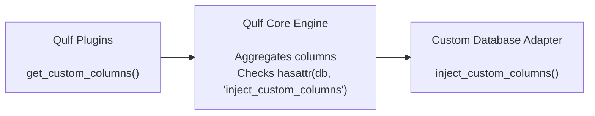

# Custom Database Adapters

If your application uses an ORM or database that Qulf does not support out of the box (such as Tortoise ORM, Peewee, Prisma, Piccolo, or raw SQL drivers), you can build a custom adapter.

Qulf splits database integration into two contracts in `qulf.adapters.base`:

1. **`DatabaseAdapter`** (Abstract Base Class): Defines all asynchronous CRUD operations for users, sessions, accounts, roles, permissions, and passkeys.
2. **`SchemaAdapter`** (Protocol): An optional structural interface for dynamic schema injection, allowing installed plugins to add required fields to your ORM models at application startup.

---

## The `SchemaAdapter` Protocol

The `SchemaAdapter` protocol enables dynamic ORM schema expansion:

```python title="qulf/adapters/base.py"
from typing import Any, Protocol

class SchemaAdapter(Protocol):
    def inject_custom_columns(self, custom_columns: dict[str, dict[str, Any]]) -> None:
        """Inject dynamic columns required by plugins into the ORM models."""
        ...
```

### Why a Protocol?

`SchemaAdapter` is defined as a Python `typing.Protocol` (structural subtyping) rather than part of `DatabaseAdapter`:

- **Relational ORMs** (SQLAlchemy, SQLModel, Django, Tortoise ORM, Peewee) have explicit table schemas. They implement `inject_custom_columns()` so plugins can attach columns to models dynamically.
- **Schemaless Databases** (such as MongoDB via Motor or document stores) do not require columns to be declared ahead of time. These adapters can either implement `inject_custom_columns()` as a no-op (`pass`) or omit it entirely.

Because it is a protocol, your custom adapter satisfies `SchemaAdapter` simply by implementing `inject_custom_columns()`. You can also inherit from both `(DatabaseAdapter, SchemaAdapter)` for explicit static typing.

---

## How Plugins Inject Custom Schema Columns

When you configure Qulf with plugins, schema injection happens during engine initialization before your application handles requests:



1. **Plugin Declaration**: When `Qulf(db=adapter, plugins=[...])` initializes, it iterates over all registered plugins and invokes their `get_custom_columns()` hook.
2. **Native ORM Escape Hatch**: Qulf checks if the plugin defines a method matching `get_{db.name}_columns()`, where `{db.name}` is the adapter's `name` attribute (for example, `get_tortoise_columns()` or `get_sqlalchemy_columns()`). If found, native ORM column definitions override or merge with generic types.
3. **Aggregation**: Qulf merges the column definitions across all plugins into a single nested dictionary.
4. **Injection**: Qulf checks if the active adapter has an `inject_custom_columns` method (`hasattr(self.db, "inject_custom_columns")`). If present, it passes the aggregated dictionary to your adapter.
5. **Model Mutation**: Your adapter iterates over the tables and columns, maps Python types to ORM field constructs, and attaches the attributes to your model classes.

---

## Structure of `custom_columns`

The `inject_custom_columns()` method receives a two-level dictionary:

```python
dict[str, dict[str, Any]]
```

- **Top-Level Keys (`str`)**: The target table or model name (e.g. `"user"`, `"session"`, `"account"`).
- **Nested Keys (`str`)**: The attribute/column name to inject (e.g. `"two_factor_secret"`, `"is_banned"`, `"strike_count"`).
- **Nested Values (`Any`)**: Either a standard Python primitive type (`str`, `int`, `bool`, `datetime`, `float`) or a native ORM column/field instance provided by an ORM-specific plugin hook.

### Example Payload

```python
{
    "user": {
        "two_factor_secret": str,
        "is_banned": bool,
        "failed_logins": int,
        "banned_until": datetime.datetime,
    },
    "session": {
        "impersonator_id": str,
    }
}
```

---

## Type Mapping & Implementation

When implementing `inject_custom_columns()`, map standard Python types to your ORM's field types.

### Common Type Mappings

| Python Type | Typical ORM Equivalent | Notes |
|---|---|---|
| `str` | `CharField(max_length=255, null=True)` / `String` | String/text field; typically nullable |
| `int` | `IntegerField(null=True)` / `Integer` | Signed integer; typically nullable |
| `bool` | `BooleanField(default=False)` / `Boolean` | Boolean flag; defaults to `False` |
| `datetime` | `DateTimeField(null=True)` / `DateTime` | Timestamp; timezone-aware UTC recommended |
| `float` | `FloatField(null=True)` / `Float` | Floating-point numeric field |
| Native ORM Field | Passthrough (`field = col_type`) | Bypasses type mapping for framework-specific definitions |
| Anything else | `JSONField(null=True)` or raise a warning | Fallback for arbitrary JSON-serializable payloads |

### Implementation Pattern

Here is a recommended pattern for implementing `inject_custom_columns()` in a custom ORM adapter:

```python title="app/adapters/custom_orm.py"
from datetime import datetime
from typing import Any
from qulf.adapters.base import DatabaseAdapter, SchemaAdapter

class CustomORMAdapter(DatabaseAdapter, SchemaAdapter):
    name = "custom_orm"

    def __init__(self, user_model, session_model, account_model):
        self.user_model = user_model
        self.session_model = session_model
        self.account_model = account_model
        
        self.models: dict[str, Any] = {
            "user": self.user_model,
            "session": self.session_model,
            "account": self.account_model,
        }

    def inject_custom_columns(self, custom_columns: dict[str, dict[str, Any]]) -> None:
        """Inject dynamic columns required by plugins into ORM models."""
        # 1. Define type mapping for your ORM
        type_mapping = {
            str: MyORMCharField(max_length=255, null=True),
            int: MyORMIntegerField(null=True),
            bool: MyORMBooleanField(default=False),
            datetime: MyORMDateTimeField(null=True),
        }

        for table_name, columns in custom_columns.items():
            model = self.models.get(table_name)
            if not model:
                # Table not managed by this adapter; skip safely
                continue

            for col_name, col_type in columns.items():
                # 2. Never overwrite pre-existing model attributes
                if hasattr(model, col_name):
                    continue

                # 3. Resolve the ORM field
                if col_type in type_mapping:
                    field = type_mapping[col_type]
                elif isinstance(col_type, MyORMBaseField):
                    # Native ORM field passed via get_custom_orm_columns()
                    field = col_type
                else:
                    field = MyORMJSONField(null=True)

                # 4. Attach the field to the model class dynamically
                # (e.g. setattr, contribute_to_class, or ORM-specific hook)
                setattr(model, col_name, field)
```

### Schemaless Adapters (e.g. MongoDB / Document Stores)

For schemaless databases like MongoDB, documents can store dynamic attributes without prior schema alteration. Implement `inject_custom_columns` as a no-op:

```python title="app/adapters/document_store.py"
class DocumentStoreAdapter(DatabaseAdapter, SchemaAdapter):
    name = "docstore"

    def inject_custom_columns(self, custom_columns: dict[str, dict[str, Any]]) -> None:
        """No-op: Document stores handle dynamic fields natively."""
        pass
```

---

## Implementing `DatabaseAdapter`

`DatabaseAdapter` is an abstract base class (`ABC`). All database operations are asynchronous.

Below is a complete reference of the abstract methods required to satisfy the `DatabaseAdapter` interface:

### 1. User Operations

```python
async def get_user_by_email_with_password(self, email: str) -> UserWithPassword | None:
    """Retrieve user with hashed password (used during sign-in verification)."""

async def get_user_by_email(self, email: str) -> User | None:
    """Retrieve public user profile by email."""

async def get_user_by_id_with_password(self, user_id: int | str) -> UserWithPassword | None:
    """Retrieve user with hashed password by user ID."""

async def get_user_by_id(self, user_id: int | str) -> User | None:
    """Retrieve public user profile by user ID."""

async def create_user(self, user_data: UserCreate, hashed_password: str) -> User:
    """Persist a new user with their hashed password."""

async def update_user(self, user_id: str | int, update_data: dict[str, Any]) -> User:
    """Update fields on an existing user."""

async def delete_user(self, user_id: str, strategy: DeletionStrategy) -> bool | None:
    """Delete a user. Soft-delete sets deleted_at; hard-delete removes the row."""
```

### 2. Session Operations

```python
async def create_session(
    self,
    user_id: int | str,
    token: str,
    expires_at: datetime,
    ip_address: str | None = None,
    user_agent: str | None = None,
) -> Session:
    """Insert a new session token record."""

async def get_session(self, token: str) -> Session | None:
    """Retrieve active session by token string."""

async def delete_session(self, token: str) -> bool:
    """Invalidate a specific session token."""

async def get_user_sessions(self, user_id: str | int) -> list[Session]:
    """Retrieve all active sessions for a user."""

async def delete_user_session(self, user_id: str | int, token: str | None = None) -> bool:
    """Delete a specific session belonging to a user."""

async def delete_all_user_sessions(
    self, user_id: str | int, except_token: str | None = None
) -> list[str]:
    """Delete all sessions for a user, optionally preserving except_token."""
```

### 3. OAuth Account Operations

```python
async def create_account(self, account_data: AccountCreate) -> Account:
    """Insert and link a third-party OAuth account."""

async def get_account_by_provider(self, provider_id: str, account_id: str) -> Account | None:
    """Retrieve OAuth account by provider name (e.g. 'github') and provider user ID."""

async def update_account(
    self, provider_id: str, account_id: str, update_data: dict[str, Any]
) -> Account | None:
    """Update OAuth tokens (access_token, refresh_token, expires_at)."""
```

### 4. Role-Based Access Control (RBAC) Operations

```python
async def create_role(self, name: str, description: str | None = None) -> Role:
    """Create a new role."""

async def get_role_by_name(self, name: str) -> Role | None:
    """Retrieve role by unique name."""

async def create_permission(self, name: str, description: str | None = None) -> Permission:
    """Create a new permission."""

async def get_permission_by_name(self, name: str) -> Permission | None:
    """Retrieve permission by unique name."""

async def assign_role_to_user(self, user_id: str | int, role_name: str) -> None:
    """Assign an existing role to a user."""

async def remove_role_from_user(self, user_id: str | int, role_name: str) -> None:
    """Remove an assigned role from a user."""

async def grant_permission_to_role(self, role_name: str, permission_name: str) -> None:
    """Associate a permission with a role."""

async def get_user_roles(self, user_id: str | int) -> list[Role]:
    """Return all roles assigned to a user."""

async def get_user_permissions(self, user_id: str | int) -> list[Permission]:
    """Return all unique permissions granted to a user across their roles."""
```

### 5. Passkey (WebAuthn) Operations

```python
async def create_passkey(self, data: PasskeyCredentialCreate) -> PasskeyCredential:
    """Persist a new registered WebAuthn passkey credential."""

async def get_passkeys_by_user(self, user_id: str | int) -> list[PasskeyCredential]:
    """List all passkey credentials registered to a user."""

async def get_passkey_by_credential_id(self, credential_id: str) -> PasskeyCredential | None:
    """Look up a passkey credential by its hex-encoded credential ID."""

async def update_passkey_sign_count(self, credential_id: str, new_sign_count: int) -> None:
    """Increment signature counter after authentication to prevent replay attacks."""

async def delete_passkey(self, credential_id: str) -> bool:
    """Delete a passkey credential by credential ID."""
```

---

## Complete Working Example

Below is a complete skeleton of a custom adapter using Tortoise ORM:

```python title="app/adapters/tortoise.py"
from datetime import datetime
from typing import Any
from tortoise import fields
from tortoise.models import Model
from qulf.adapters.base import DatabaseAdapter, SchemaAdapter
from qulf.config import DeletionStrategy
from qulf.types import (
    Account,
    AccountCreate,
    PasskeyCredential,
    PasskeyCredentialCreate,
    Permission,
    Role,
    Session,
    User,
    UserCreate,
    UserWithPassword,
)

class TortoiseAdapter(DatabaseAdapter, SchemaAdapter):
    name = "tortoise"

    def __init__(self, user_model: type[Model], session_model: type[Model]):
        self.user_model = user_model
        self.session_model = session_model
        self.models: dict[str, type[Model]] = {
            "user": self.user_model,
            "session": self.session_model,
        }

    # --- SchemaAdapter implementation ---
    def inject_custom_columns(self, custom_columns: dict[str, dict[str, Any]]) -> None:
        type_mapping = {
            str: fields.CharField(max_length=255, null=True),
            int: fields.IntField(null=True),
            bool: fields.BooleanField(default=False),
            datetime: fields.DatetimeField(null=True),
        }

        for table_name, columns in custom_columns.items():
            model = self.models.get(table_name)
            if not model:
                continue

            for col_name, col_type in columns.items():
                if hasattr(model, col_name):
                    continue

                field = type_mapping.get(col_type, fields.JSONField(null=True))
                # Attach dynamically to Tortoise model
                model.add_to_class(col_name, field)

    # --- DatabaseAdapter CRUD methods ---
    async def get_user_by_email_with_password(self, email: str) -> UserWithPassword | None:
        record = await self.user_model.filter(email=email).first()
        return UserWithPassword.model_validate(record) if record else None

    async def get_user_by_email(self, email: str) -> User | None:
        record = await self.user_model.filter(email=email).first()
        return User.model_validate(record) if record else None

    async def get_user_by_id(self, user_id: int | str) -> User | None:
        record = await self.user_model.filter(id=user_id).first()
        return User.model_validate(record) if record else None

    async def get_user_by_id_with_password(self, user_id: int | str) -> UserWithPassword | None:
        record = await self.user_model.filter(id=user_id).first()
        return UserWithPassword.model_validate(record) if record else None

    async def create_user(self, user_data: UserCreate, hashed_password: str) -> User:
        data = user_data.model_dump()
        data["hashed_password"] = hashed_password
        record = await self.user_model.create(**data)
        return User.model_validate(record)

    async def update_user(self, user_id: str | int, update_data: dict[str, Any]) -> User:
        await self.user_model.filter(id=user_id).update(**update_data)
        record = await self.user_model.filter(id=user_id).first()
        return User.model_validate(record)

    async def delete_user(self, user_id: str, strategy: DeletionStrategy) -> bool | None:
        if strategy == DeletionStrategy.SOFT:
            await self.user_model.filter(id=user_id).update(deleted_at=datetime.utcnow())
            return True
        deleted_count = await self.user_model.filter(id=user_id).delete()
        return bool(deleted_count)

    # Implement session, account, RBAC, and passkey methods similarly...
```

---

## Best Practices

1. **Set `name` Attribute**: Always set `name: str` on your adapter (e.g. `name = "tortoise"`). This allows plugins to offer optimized column definitions using `get_{name}_columns()`.
2. **Do Not Overwrite Existing Attributes**: Always check `if hasattr(model, col_name)` before attaching a dynamic column. Applications may already define custom columns on their models.
3. **Handle Native ORM Types**: If a plugin provides native ORM column instances (via `get_{orm}_columns()`), detect and attach them directly instead of falling back to default type mapping.
4. **JWT-Only Session Optimization**: If your application uses stateless JWT sessions exclusively, database session methods can return empty collections.
5. **CLI Schema Migrations**: For production environments, run `qulf sync` to statically inspect plugin schemas and write concrete ORM migration files rather than relying exclusively on runtime reflection.

---

## See Also

- [SQLAlchemy Adapter](/docs/adapters/sqlalchemy) — Production SQLAlchemy 2.0+ adapter implementation
- [SQLModel Adapter](/docs/adapters/sqlmodel) — SQLModel integration with dynamic column mapping
- [Django ORM Adapter](/docs/adapters/django) — Django ORM adapter with `contribute_to_class`
- [MongoDB (Motor) Adapter](/docs/adapters/motor) — Schemaless async adapter
- [Building Custom Plugins](/docs/plugins/custom) — Defining `get_custom_columns()` in plugins
- [CLI Reference](/docs/cli) — Generating static migrations with `qulf sync`
