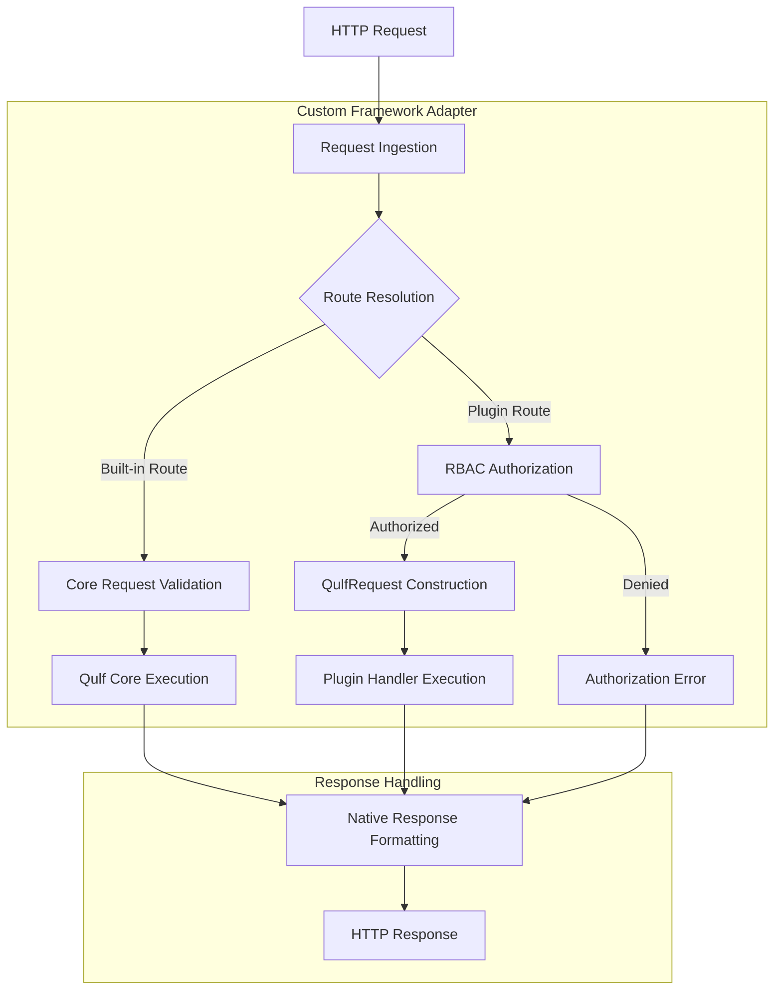

# Custom Framework Adapters

If your application uses an asynchronous toolkit, micro-framework, or proprietary server not supported out of the box (Sanic, Falcon, aiohttp, Tornado, or custom ASGI servers), you can write a custom framework adapter.

Qulf's architecture cleanly separates authentication rules and plugin logic from the underlying HTTP layer. Framework adapters serve as thin translation layers: they ingest framework-native HTTP requests, validate incoming payloads against standard Qulf request models, execute Qulf core routines or dynamic plugin route handlers, and format the output into framework-native HTTP responses.



> [!NOTE]
> Qulf currently provides official adapters for **FastAPI**, **Litestar**, **Flask**, and **Django**. Dedicated integration guides and ready-made packages for frameworks like **Sanic** and **aiohttp** will be added soon. In the meantime, this guide provides everything you need to implement your own adapter.

---

## Base Request Models (`qulf.frameworks.base`)

Qulf defines standard Pydantic models for built-in authentication routes in `qulf.frameworks.base`. These models are also re-exported directly from `qulf.frameworks`.

All official adapters and custom adapters use these models to parse, validate, and enforce strict type contracts on incoming JSON payloads.

```python title="qulf_custom_framework.py"
from qulf.frameworks import (
    SignInRequest,
    ForgotPasswordRequest,
    ResetPasswordRequest,
    VerifyEmailRequest,
    ChangePasswordRequest,
)
```

### Models Overview

| Request Model | Source Module | Target Endpoint | Key Fields | Description |
|---|---|---|---|---|
| [`SignInRequest`](#signinrequest) | `qulf.frameworks.base` | `POST /sign-in` | `email`, `password` | Validates credentials for user authentication. |
| [`ForgotPasswordRequest`](#forgotpasswordrequest) | `qulf.frameworks.base` | `POST /forgot-password` | `email` | Validates email address format for password recovery. |
| [`ResetPasswordRequest`](#resetpasswordrequest) | `qulf.frameworks.base` | `POST /reset-password` | `token`, `new_password` | Validates reset token and new replacement password. |
| [`VerifyEmailRequest`](#verifyemailrequest) | `qulf.frameworks.base` | `POST /verify-email` | `token` | Validates token submitted to verify email address. |
| [`ChangePasswordRequest`](#changepasswordrequest) | `qulf.frameworks.base` | `POST /change-password` | `old_password`, `new_password` | Authenticated request verifying current password before setting new one. |
| [`UserCreate`](#usercreate-registration-model) | `qulf.types` | `POST /sign-up` | `email`, `password`, `name`, ... | Standard Pydantic model for user registration. |

---

### `SignInRequest`

Validates credentials submitted during standard username/email and password sign-in.

```python title="qulf/frameworks/base.py"
from pydantic import BaseModel

class SignInRequest(BaseModel):
    email: str
    password: str
```

- **Fields:**
  - `email` (`str`): The user's account identifier or email address.
  - `password` (`str`): The user's plain-text password for credential verification.
- **Used by:** `POST /sign-in` handler.
- **2FA Challenge:** If two-factor authentication is active on the account, `auth.sign_in()` raises `Requires2FAError` (from `qulf.exceptions`). Your adapter must catch this exception and return HTTP 401 with `{"detail": "2FA required", "temp_token": err.temp_token}` so the client can complete verification via a 2FA plugin endpoint (such as TOTP or Passkey).

---

### `ForgotPasswordRequest`

Validates payloads requesting a password reset email or reset token.

```python title="qulf/frameworks/base.py"
from pydantic import BaseModel, EmailStr

class ForgotPasswordRequest(BaseModel):
    email: EmailStr
```

- **Fields:**
  - `email` (`EmailStr`): The email address associated with the account. Pydantic validates this against RFC email standards.
- **Used by:** `POST /forgot-password` handler.
- **Engine interaction:** Passes `payload.email` to `await auth.generate_password_reset_token(payload.email)`.

---

### `ResetPasswordRequest`

Validates payloads submitted when a user resets their password with a recovery token.

```python title="qulf/frameworks/base.py"
from pydantic import BaseModel

class ResetPasswordRequest(BaseModel):
    token: str
    new_password: str
```

- **Fields:**
  - `token` (`str`): The one-time password reset token issued by Qulf.
  - `new_password` (`str`): The desired new password.
- **Used by:** `POST /reset-password` handler.
- **Engine interaction:** Passes `payload.token` and `payload.new_password` to `await auth.reset_password(...)`.

---

### `VerifyEmailRequest`

Validates payloads submitted to confirm an email address verification token.

```python title="qulf/frameworks/base.py"
from pydantic import BaseModel

class VerifyEmailRequest(BaseModel):
    token: str
```

- **Fields:**
  - `token` (`str`): The verification token issued upon registration or email change.
- **Used by:** `POST /verify-email` handler.
- **Engine interaction:** Passes `payload.token` to `await auth.verify_email(payload.token)`.

---

### `ChangePasswordRequest`

Validates authenticated requests to update the current user's password.

```python title="qulf/frameworks/base.py"
from pydantic import BaseModel

class ChangePasswordRequest(BaseModel):
    old_password: str
    new_password: str
```

- **Fields:**
  - `old_password` (`str`): The current password, used to confirm the user's identity.
  - `new_password` (`str`): The new password to set.
- **Used by:** `POST /change-password` handler.
- **Engine interaction:** Requires an active session; extracts `user.id` and passes `(user.id, payload.old_password, payload.new_password)` to `await auth.change_password(...)`.

---

### `UserCreate` (Registration Model)

Unlike the base request models which live in `qulf.frameworks.base`, user registration relies on `UserCreate` from `qulf.types`:

```python title="qulf/types.py"
from pydantic import BaseModel, EmailStr

class UserCreate(BaseModel):
    email: EmailStr
    password: str
    name: str | None = None
```

- **Used by:** `POST /sign-up` handler.
- **Engine interaction:** Passes `payload` to `await auth.sign_up(payload)`. Returns the newly created `User` object.

---

## Validating Requests in Custom Adapters

Depending on your web framework's architecture, you can consume these models either declaratively or imperatively.

### 1. Declarative Validation (FastAPI, Litestar)

Frameworks that integrate directly with Pydantic parse and validate request bodies automatically through route handler type annotations:

```python title="app/routes/auth.py"
from qulf.frameworks.base import SignInRequest

@router.post("/sign-in")
async def sign_in(payload: SignInRequest, request: Request, response: Response):
    session = await auth.sign_in(
        email=payload.email,
        password=payload.password,
        ip_address=request.client.host if request.client else None,
        user_agent=request.headers.get("user-agent"),
    )
    # Apply cookie and return response
```

### 2. Imperative Validation (Flask, Django, Sanic, Falcon, aiohttp)

For frameworks without automatic Pydantic request injection, validate the parsed JSON body manually using `model_validate()`:

```python title="app/handlers/auth.py"
from pydantic import ValidationError
from qulf.exceptions import QulfException, Requires2FAError
from qulf.frameworks.base import SignInRequest

async def handle_sign_in(raw_json: dict, client_ip: str | None, user_agent: str | None):
    # 1. Validate payload against Pydantic model
    try:
        payload = SignInRequest.model_validate(raw_json)
    except ValidationError as err:
        return {"detail": str(err)}, 400, None

    # 2. Execute core sign-in
    try:
        session = await auth.sign_in(
            payload.email, payload.password, client_ip, user_agent
        )
        return {"message": "Signed in successfully"}, 200, session
    except Requires2FAError as err:
        # 2FA challenge required
        return {"detail": "2FA required", "temp_token": err.temp_token}, 401, None
    except QulfException as err:
        return {"detail": str(err)}, 400, None
```

---

## The Routing Contract (`qulf.routing`)

When plugins expose dynamic routes, framework adapters bridge native HTTP requests and responses with Qulf's routing models: `QulfRoute`, `QulfRequest`, `CookieOptions`, and `QulfResponse`.

### `QulfRoute`

Defined in `qulf.routing`, plugins declare their endpoints using `QulfRoute`:

```python title="qulf/routing.py"
from collections.abc import Awaitable, Callable, Sequence
from enum import Enum
from pydantic import BaseModel, Field

class HttpMethod(str, Enum):
    DELETE = "DELETE"
    GET = "GET"
    HEAD = "HEAD"
    OPTIONS = "OPTIONS"
    PATCH = "PATCH"
    POST = "POST"
    PUT = "PUT"
    TRACE = "TRACE"

class QulfRoute(BaseModel):
    path: str
    methods: Sequence[HttpMethod]
    handler: Callable[[QulfRequest], Awaitable[QulfResponse]]
    require_roles: list[str] = Field(default_factory=list)
    require_permissions: list[str] = Field(default_factory=list)
```

- `path`: URL pattern, using OpenAPI `{param}` syntax (e.g. `/oauth/{provider}/login`).
- `methods`: Permitted HTTP methods (`[HttpMethod.GET, HttpMethod.POST]`).
- `handler`: An async callable accepting a `QulfRequest` and returning a `QulfResponse`.
- `require_roles`: List of role names required to access this endpoint.
- `require_permissions`: List of permission names required to access this endpoint.

---

### `QulfRequest`

Defined in `qulf.routing`, `QulfRequest` is the framework-agnostic request model passed into all plugin route handlers:

```python title="qulf/routing.py"
from typing import Any
from pydantic import BaseModel

class QulfRequest(BaseModel):
    body: dict[str, Any] = {}
    query_params: dict[str, str] = {}
    path_params: dict[str, str] = {}
    cookies: dict[str, str] = {}
    ip_address: str | None = None
    user_agent: str | None = None
```

| Field | Type | Description |
|---|---|---|
| `body` | `dict[str, Any]` | Parsed JSON request payload (defaults to empty dict `{}`). |
| `query_params` | `dict[str, str]` | URL query parameters as key-value string pairs. |
| `path_params` | `dict[str, str]` | Path parameters extracted by the framework (e.g. `{"provider": "github"}`). |
| `cookies` | `dict[str, str]` | Incoming HTTP cookie names and string values. |
| `ip_address` | `str \| None` | Remote client IP address (`ip_address`, not `client_ip`). |
| `user_agent` | `str \| None` | Content of the incoming `User-Agent` HTTP header. |

> [!NOTE]
> `QulfRequest` does not store the HTTP method, raw URL, or unparsed headers. Plugin handlers receive clean, normalized state.

---

### `CookieOptions`

Defined in `qulf.routing`, `CookieOptions` specifies the attributes of a cookie returned by a plugin handler:

```python title="qulf/routing.py"
from typing import Literal
from pydantic import BaseModel

class CookieOptions(BaseModel):
    key: str
    value: str
    httponly: bool = True
    secure: bool = True
    samesite: Literal["lax", "none", "strict"] = "lax"
```

> [!TIP]
> **Field Naming Convention**:
> - In `CookieOptions`, the fields are `httponly` and `samesite` (single lowercase word).
> - In `auth.config.cookies` (core engine configuration), the fields are `http_only` and `same_site` (snake_case).

---

### `QulfResponse`

Defined in `qulf.routing`, plugin route handlers always return an instance of `QulfResponse`:

```python title="qulf/routing.py"
class QulfResponse(BaseModel):
    status_code: int = 200
    body: dict[str, Any] | None = None
    headers: dict[str, str] = {}
    set_cookies: list[CookieOptions] = []
    delete_cookies: list[str] = []
```

> [!IMPORTANT]
> `QulfResponse` cleanly separates cookie operations:
> - **`set_cookies`**: A list of `CookieOptions` instances to attach to the outgoing response.
> - **`delete_cookies`**: A list of cookie names (`str`) that must be deleted or expired on the client.

---

## Core Endpoints Reference

A complete framework adapter must expose the following built-in authentication endpoints:

| Method | Path | Request Body Model | Auth Required | Description |
|---|---|---|:---:|---|
| `POST` | `/sign-up` | `UserCreate` (`qulf.types`) | No | Registers a new user. |
| `POST` | `/sign-in` | `SignInRequest` | No | Authenticates user; sets session cookie. |
| `GET` | `/session` | None | Yes | Returns active session and user data. |
| `POST` | `/sign-out` | None | No | Revokes current session and deletes session cookie. |
| `POST` | `/forgot-password` | `ForgotPasswordRequest` | No | Generates a password reset token. |
| `POST` | `/reset-password` | `ResetPasswordRequest` | No | Resets password using valid token. |
| `POST` | `/verify-email` | `VerifyEmailRequest` | No | Marks user email as verified. |
| `POST` | `/change-password` | `ChangePasswordRequest` | Yes | Changes authenticated user's password. |
| `DELETE` | `/delete-account` | None | Yes | Deletes account, revokes sessions, clears cookie. |

---

## Handling Dynamic Plugin Routes

When Qulf is configured with plugins (e.g. OAuth, Passkey, TOTP, Magic Link), each plugin exposes dynamic routes through `plugin.get_routes()`.

Your custom framework adapter iterates through all registered plugins, inspects each `QulfRoute`, and registers corresponding endpoints on your framework router:

```python title="qulf_custom_framework.py"
for plugin in auth.plugins.values():
    for qulf_route in plugin.get_routes():
        register_route(
            path=translate_path_syntax(qulf_route.path),
            methods=[m.value for m in qulf_route.methods],
            handler=create_endpoint_handler(auth, qulf_route),
        )
```

> [!TIP]
> **Path Parameter Syntax**: Qulf route definitions use OpenAPI bracket syntax (e.g. `/oauth/{provider}/login`). Different frameworks handle path parameters differently:
> - **Flask** expects `<provider>`: `path.replace("{", "<").replace("}", ">")`
> - **Django** expects path converters: `re.sub(r"\{(\w+)\}", r"<str:\1>", path).lstrip("/")`
> - **Litestar** and **FastAPI** natively support `{provider}` directly.

### 1. Enforcing Role-Based Access Control (RBAC)

When `qulf_route.require_roles` or `qulf_route.require_permissions` is non-empty, verify the session before dispatching to `qulf_route.handler`:

```python title="qulf_custom_framework.py"
if qulf_route.require_roles or qulf_route.require_permissions:
    session_data = await auth.get_session_from_cookies(native_request.cookies)
    if not session_data:
        return create_response({"detail": "Authentication required"}, status_code=401)

    _, user = session_data

    # Check each required role
    for role in qulf_route.require_roles:
        if not await auth.has_role(user, role):
            return create_response(
                {"detail": f"Missing required role: '{role}'"},
                status_code=403,
            )

    # Check each required permission
    for perm in qulf_route.require_permissions:
        if not await auth.has_permission(user, perm):
            return create_response(
                {"detail": f"Missing required permission: '{perm}'"},
                status_code=403,
            )
```

### 2. Ingesting Native Requests into `QulfRequest`

Extract incoming request details and construct `QulfRequest`:

```python title="qulf_custom_framework.py"
# Safely parse JSON body for mutating HTTP methods
body: dict[str, Any] = {}
if native_request.method in ["POST", "PUT", "PATCH"]:
    try:
        body = await native_request.json() or {}
    except Exception:
        # Delegate validation to plugin handler
        pass

qulf_request = QulfRequest(
    body=body,
    query_params=dict(native_request.query_params),
    path_params=dict(native_request.path_params),
    cookies=dict(native_request.cookies),
    ip_address=native_request.client_ip,
    user_agent=native_request.headers.get("user-agent"),
)
```

### 3. Translating `QulfResponse` to Native Responses

Execute `qulf_response = await qulf_route.handler(qulf_request)` and translate status codes, headers, and cookies:

```python title="qulf_custom_framework.py"
# 1. Instantiate native response with status code and body
native_response = create_response(
    body=qulf_response.body if qulf_response.body is not None else {},
    status_code=qulf_response.status_code,
)

# 2. Attach response headers
for key, value in qulf_response.headers.items():
    native_response.headers[key] = value

# 3. Apply set_cookies (CookieOptions)
for cookie in qulf_response.set_cookies:
    native_response.set_cookie(
        key=cookie.key,
        value=cookie.value,
        httponly=cookie.httponly,
        secure=cookie.secure,
        samesite=cookie.samesite,
    )

# 4. Apply delete_cookies
for cookie_name in qulf_response.delete_cookies:
    native_response.delete_cookie(key=cookie_name)
```

---

## Route Protection Helpers (RBAC)

To protect non-auth application routes, custom adapters can provide decorators or dependency functions.

```python title="qulf_custom_framework.py"
import functools
from typing import Callable, Literal
from qulf.core import Qulf

def requires_role(
    auth: Qulf,
    roles: str | list[str],
    mode: Literal["all", "any"] = "all",
):
    """Decorator to enforce role requirements on custom framework handlers."""
    required = [roles] if isinstance(roles, str) else list(roles)

    def decorator(func: Callable):
        @functools.wraps(func)
        async def wrapper(request, *args, **kwargs):
            session_data = await auth.get_session_from_cookies(request.cookies)
            if not session_data:
                return {"detail": "Authentication required"}, 401

            _, user = session_data

            if mode == "all":
                for role in required:
                    if not await auth.has_role(user, role):
                        return {"detail": f"Missing required role: '{role}'"}, 403
            else:
                has_any = False
                for role in required:
                    if await auth.has_role(user, role):
                        has_any = True
                        break
                if not has_any:
                    return {"detail": "Missing required role"}, 403

            request.state_user = user
            return await func(request, *args, **kwargs)

        return wrapper
    return decorator


def requires_permission(
    auth: Qulf,
    permissions: str | list[str],
    mode: Literal["all", "any"] = "all",
):
    """Decorator to enforce permission requirements on custom framework handlers."""
    required = [permissions] if isinstance(permissions, str) else list(permissions)

    def decorator(func: Callable):
        @functools.wraps(func)
        async def wrapper(request, *args, **kwargs):
            session_data = await auth.get_session_from_cookies(request.cookies)
            if not session_data:
                return {"detail": "Authentication required"}, 401

            _, user = session_data

            if mode == "all":
                for perm in required:
                    if not await auth.has_permission(user, perm):
                        return {"detail": f"Missing required permission: '{perm}'"}, 403
            else:
                has_any = False
                for perm in required:
                    if await auth.has_permission(user, perm):
                        has_any = True
                        break
                if not has_any:
                    return {"detail": "Missing required permission"}, 403

            request.state_user = user
            return await func(request, *args, **kwargs)

        return wrapper
    return decorator
```

---

## Full Adapter Implementation Example

Here is a complete, modular implementation of a custom framework adapter that wires up core authentication routes, handles 2FA, manages cookies, and dynamically registers plugin routes:

```python title="qulf_custom_framework.py"
from dataclasses import dataclass, field
from typing import Any, Callable
from pydantic import ValidationError

from qulf.core import Qulf
from qulf.exceptions import QulfException, Requires2FAError
from qulf.frameworks.base import (
    ChangePasswordRequest,
    ForgotPasswordRequest,
    ResetPasswordRequest,
    SignInRequest,
    VerifyEmailRequest,
)
from qulf.routing import CookieOptions, QulfRequest, QulfResponse, QulfRoute
from qulf.types import UserCreate


@dataclass
class CustomResponse:
    """response object returned by your custom framework endpoints."""
    body: Any = None
    status_code: int = 200
    headers: dict[str, str] = field(default_factory=dict)
    set_cookies: list[CookieOptions] = field(default_factory=list)
    delete_cookies: list[str] = field(default_factory=list)


class CustomRouter:
    """Mock router representing your custom framework router."""
    def __init__(self):
        self.routes = []

    def add_route(self, path: str, methods: list[str], handler: Callable):
        self.routes.append((path, methods, handler))


def serve_qulf_custom(auth: Qulf) -> CustomRouter:
    router = CustomRouter()

    # Helper: Safely parse JSON body from native request
    async def parse_json(req) -> dict[str, Any]:
        try:
            return await req.json() or {}
        except Exception:
            return {}

    # Helper: Extract authenticated user from session cookie
    async def get_authenticated_user(req):
        session_data = await auth.get_session_from_cookies(req.cookies)
        if not session_data:
            return None
        _, user = session_data
        return user

    # Authentication Routes 

    async def sign_up_handler(req) -> CustomResponse:
        try:
            raw_body = await parse_json(req)
            body = UserCreate.model_validate(raw_body)
            user = await auth.sign_up(body)
            return CustomResponse(body={"user": user.model_dump()}, status_code=201)
        except (ValidationError, QulfException) as err:
            return CustomResponse(body={"detail": str(err)}, status_code=400)

    async def sign_in_handler(req) -> CustomResponse:
        try:
            raw_body = await parse_json(req)
            body = SignInRequest.model_validate(raw_body)
            session = await auth.sign_in(
                body.email, body.password, req.ip_address, req.user_agent
            )
            cookies = [
                CookieOptions(
                    key=auth.config.cookies.name,
                    value=session.token,
                    httponly=auth.config.cookies.http_only,
                    secure=auth.config.cookies.secure,
                    samesite=auth.config.cookies.same_site,
                )
            ]
            return CustomResponse(
                body={"message": "Signed in successfully"},
                status_code=200,
                set_cookies=cookies,
            )
        except Requires2FAError as err:
            # Return 401 with challenge temp_token for 2FA plugin completion
            return CustomResponse(
                body={"detail": "2FA required", "temp_token": err.temp_token},
                status_code=401,
            )
        except (ValidationError, QulfException) as err:
            return CustomResponse(body={"detail": str(err)}, status_code=400)

    async def session_handler(req) -> CustomResponse:
        session_data = await auth.get_session_from_cookies(req.cookies)
        if not session_data:
            return CustomResponse(body={"detail": "Unauthorized"}, status_code=401)
        session, user = session_data
        return CustomResponse(
            body={"session": session.model_dump(), "user": user.model_dump()},
            status_code=200,
        )

    async def sign_out_handler(req) -> CustomResponse:
        token = req.cookies.get(auth.config.cookies.name)
        if token:
            await auth.sign_out(token)
        return CustomResponse(
            body={"message": "Signed out"},
            status_code=200,
            delete_cookies=[auth.config.cookies.name],
        )

    async def forgot_password_handler(req) -> CustomResponse:
        try:
            raw_body = await parse_json(req)
            body = ForgotPasswordRequest.model_validate(raw_body)
            await auth.generate_password_reset_token(body.email)
            return CustomResponse(body={"message": "Reset link generated"}, status_code=200)
        except (ValidationError, QulfException) as err:
            return CustomResponse(body={"detail": str(err)}, status_code=400)

    async def reset_password_handler(req) -> CustomResponse:
        try:
            raw_body = await parse_json(req)
            body = ResetPasswordRequest.model_validate(raw_body)
            await auth.reset_password(body.token, body.new_password)
            return CustomResponse(body={"message": "Password reset successfully"}, status_code=200)
        except (ValidationError, QulfException) as err:
            return CustomResponse(body={"detail": str(err)}, status_code=400)

    async def verify_email_handler(req) -> CustomResponse:
        try:
            raw_body = await parse_json(req)
            body = VerifyEmailRequest.model_validate(raw_body)
            await auth.verify_email(body.token)
            return CustomResponse(body={"message": "Email verified successfully"}, status_code=200)
        except (ValidationError, QulfException) as err:
            return CustomResponse(body={"detail": str(err)}, status_code=400)

    async def change_password_handler(req) -> CustomResponse:
        user = await get_authenticated_user(req)
        if not user:
            return CustomResponse(body={"detail": "Unauthorized"}, status_code=401)

        try:
            raw_body = await parse_json(req)
            body = ChangePasswordRequest.model_validate(raw_body)
            await auth.change_password(user.id, body.old_password, body.new_password)
            return CustomResponse(body={"message": "Password changed successfully"}, status_code=200)
        except (ValidationError, QulfException) as err:
            return CustomResponse(body={"detail": str(err)}, status_code=400)

    async def delete_account_handler(req) -> CustomResponse:
        user = await get_authenticated_user(req)
        if not user:
            return CustomResponse(body={"detail": "Unauthorized"}, status_code=401)

        try:
            await auth.revoke_all_user_sessions(user.id)
            await auth.delete_account(user.id)
            return CustomResponse(
                body={"message": "Account deleted successfully"},
                status_code=200,
                delete_cookies=[auth.config.cookies.name],
            )
        except QulfException as err:
            return CustomResponse(body={"detail": str(err)}, status_code=400)

    # Register standard core routes
    router.add_route("/sign-up", ["POST"], sign_up_handler)
    router.add_route("/sign-in", ["POST"], sign_in_handler)
    router.add_route("/sign-out", ["POST"], sign_out_handler)
    router.add_route("/session", ["GET"], session_handler)
    router.add_route("/forgot-password", ["POST"], forgot_password_handler)
    router.add_route("/reset-password", ["POST"], reset_password_handler)
    router.add_route("/verify-email", ["POST"], verify_email_handler)
    router.add_route("/change-password", ["POST"], change_password_handler)
    router.add_route("/delete-account", ["DELETE"], delete_account_handler)

    # Mount Dynamic Plugin Routes
    for plugin in auth.plugins.values():
        for qulf_route in plugin.get_routes():
            def make_plugin_handler(route_def: QulfRoute):
                async def handler(req) -> CustomResponse:
                    # Enforce RBAC
                    if route_def.require_roles or route_def.require_permissions:
                        session_data = await auth.get_session_from_cookies(req.cookies)
                        if not session_data:
                            return CustomResponse(
                                body={"detail": "Authentication required"},
                                status_code=401,
                            )
                        _, user = session_data

                        for role in route_def.require_roles:
                            if not await auth.has_role(user, role):
                                return CustomResponse(
                                    body={"detail": f"Missing required role: '{role}'"},
                                    status_code=403,
                                )

                        for perm in route_def.require_permissions:
                            if not await auth.has_permission(user, perm):
                                return CustomResponse(
                                    body={"detail": f"Missing required permission: '{perm}'"},
                                    status_code=403,
                                )

                    # Parse request body for mutating methods
                    body = {}
                    if req.method in ["POST", "PUT", "PATCH"]:
                        body = await parse_json(req)

                    # Construct agnostic QulfRequest
                    qulf_req = QulfRequest(
                        body=body,
                        query_params=dict(req.query_params),
                        path_params=dict(req.path_params),
                        cookies=dict(req.cookies),
                        ip_address=req.ip_address,
                        user_agent=req.user_agent,
                    )

                    # Invoke plugin handler and map QulfResponse to CustomResponse
                    qulf_res: QulfResponse = await route_def.handler(qulf_req)
                    return CustomResponse(
                        body=qulf_res.body,
                        status_code=qulf_res.status_code,
                        headers=qulf_res.headers,
                        set_cookies=qulf_res.set_cookies,
                        delete_cookies=qulf_res.delete_cookies,
                    )

                return handler

            methods = [m.value for m in qulf_route.methods]
            router.add_route(qulf_route.path, methods, make_plugin_handler(qulf_route))

    return router
```

---

## See Also

- [Routing Architecture](/docs/routing): Complete guide to `QulfRoute`, `QulfRequest`, `CookieOptions`, and `QulfResponse`.
- [Custom Database Adapters](/docs/adapters/custom): Implementing custom database and schema adapters.
- [Custom Plugins](/docs/plugins/custom): Defining custom plugins and exposing routes via `get_routes()`.
- [API Reference](/docs/api-reference): Core engine methods, session management, and configuration.
