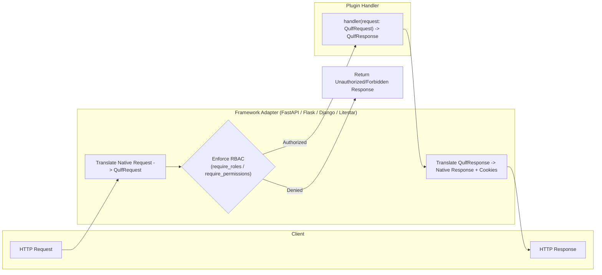
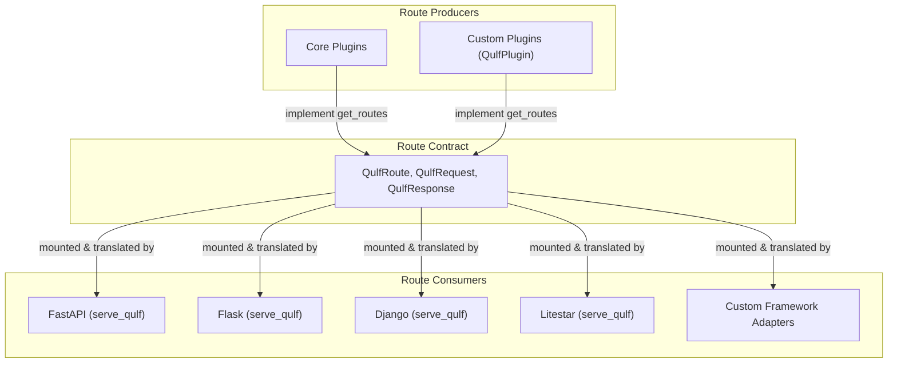

Qulf is designed from the ground up to be completely independent of any single HTTP web framework. The routing system in `src/qulf/routing.py` provides a standardized, framework-agnostic abstraction layer for defining HTTP routes, handling requests, configuring cookies, and generating responses.

Instead of binding authentication endpoints directly to Starlette, Flask, Django, or Litestar, Qulf plugins define their routes against generic data models (`QulfRoute`, `QulfRequest`, `QulfResponse`). Framework adapters then translate these models into native framework routes, handling parameter transformations, cookie setting, and automatic Role-Based Access Control (RBAC) enforcement.



---

# Core Models

All routing classes are defined in `src/qulf/routing.py` and re-exported at the package root (`qulf.routing` or `qulf`).

## `HttpMethod`

An enumeration of standard HTTP methods used to declare allowable methods for a route.

```python title="src/qulf/routing.py"
from enum import Enum

class HttpMethod(str, Enum):
    DELETE = "DELETE"
    GET = "GET"
    HEAD = "HEAD"
    OPTIONS = "OPTIONS"
    PATCH = "PATCH"
    POST = "POST"
    PUT = "PUT"
    TRACE = "TRACE"
```

## `QulfRequest`

A normalized representation of an incoming HTTP request. When a request hits a framework adapter, the adapter extracts the headers, parameters, cookies, and body, bundling them into this agnostic Pydantic model before passing it to the plugin handler.

```python title="src/qulf/routing.py"
from typing import Any
from pydantic import BaseModel

class QulfRequest(BaseModel):
    body: dict[str, Any] = {}
    query_params: dict[str, str] = {}
    path_params: dict[str, str] = {}
    cookies: dict[str, str] = {}
    ip_address: str | None = None
    user_agent: str | None = None
```

| Field | Type | Description |
|---|---|---|
| `body` | `dict[str, Any]` | Parsed JSON request payload (default: `{}`) |
| `query_params` | `dict[str, str]` | URL query string key-value pairs |
| `path_params` | `dict[str, str]` | Extracted path parameters (e.g. `{"provider": "github"}`) |
| `cookies` | `dict[str, str]` | Incoming HTTP cookies parsed as string key-value pairs |
| `ip_address` | `str \| None` | Remote client IP address (extracted via framework remote address / host) |
| `user_agent` | `str \| None` | Value of the `User-Agent` HTTP header |

## `CookieOptions`

A declarative model for issuing HTTP cookies in responses. Framework adapters inspect these objects to set secure, framework-specific cookies.

```python title="src/qulf/routing.py"
from typing import Literal
from pydantic import BaseModel

class CookieOptions(BaseModel):
    key: str
    value: str
    httponly: bool = True
    secure: bool = True
    samesite: Literal["lax", "none", "strict"] = "lax"
```

| Field | Type | Default | Description |
|---|---|---|---|
| `key` | `str` | *required* | The cookie name (e.g., `QULF_SESSION` or `qulf_oauth_state`) |
| `value` | `str` | *required* | The cookie string value |
| `httponly` | `bool` | `True` | Prevents client-side scripts from accessing the cookie |
| `secure` | `bool` | `True` | Ensures cookie is transmitted only over HTTPS |
| `samesite` | `Literal["lax", "none", "strict"]` | `"lax"` | Controls cross-site cookie transmission policy |

## `QulfResponse`

A normalized response object returned by route handlers.

```python title="src/qulf/routing.py"
from typing import Any
from pydantic import BaseModel

class QulfResponse(BaseModel):
    status_code: int = 200
    body: dict[str, Any] | None = None
    headers: dict[str, str] = {}
    set_cookies: list[CookieOptions] = []
    delete_cookies: list[str] = []
```

| Field | Type | Default | Description |
|---|---|---|---|
| `status_code` | `int` | `200` | HTTP status code for the response |
| `body` | `dict[str, Any] \| None` | `None` | JSON-serializable dictionary returned to the client |
| `headers` | `dict[str, str]` | `{}` | Custom HTTP response headers |
| `set_cookies` | `list[CookieOptions]` | `[]` | List of cookies to issue to the client |
| `delete_cookies` | `list[str]` | `[]` | Names of cookies to clear on the client |

## `QulfRoute`

Defines an individual endpoint configuration exposed by a plugin.

```python title="src/qulf/routing.py"
from collections.abc import Awaitable, Callable, Sequence
from pydantic import BaseModel, ConfigDict, Field

class QulfRoute(BaseModel):
    model_config = ConfigDict(arbitrary_types_allowed=True)

    path: str
    methods: Sequence[HttpMethod]
    handler: Callable[[QulfRequest], Awaitable[QulfResponse]]
    require_roles: list[str] = Field(default_factory=list)
    require_permissions: list[str] = Field(default_factory=list)
```

| Field | Type | Description |
|---|---|---|
| `path` | `str` | URL path pattern using bracket notation, e.g. `/oauth/{provider}/login` or `/session/list` |
| `methods` | `Sequence[HttpMethod]` | Allowed HTTP methods (e.g., `[HttpMethod.GET]` or `["POST"]`) |
| `handler` | `Callable[[QulfRequest], Awaitable[QulfResponse]]` | Asynchronous function handling the normalized request |
| `require_roles` | `list[str]` | Roles required to access this endpoint (enforced by framework adapters) |
| `require_permissions` | `list[str]` | Permissions required to access this endpoint (enforced by framework adapters) |

---

# Who Uses Routing?

In the Qulf codebase, routing is the bridge connecting **Plugins** (which produce routes) and **Framework Adapters** (which consume and serve routes).



## 1. Plugins: Route Producers

All Qulf plugins extend `QulfPlugin` (from `src/qulf/plugins/base.py`). The base class declares:

```python title="src/qulf/plugins/base.py"
class QulfPlugin:
    def get_routes(self) -> list[QulfRoute]:
        """Returns a list of generic routes to be mounted by the framework."""
        return []
```

Every official Qulf plugin that provides HTTP interaction implements `get_routes()`:

### `SessionManagementPlugin` (`src/qulf/plugins/session.py`)
Exposes session inspection and revocation endpoints:
*   `GET /session/list` - Validates the active session token, queries user sessions from the database adapter, and returns sanitized sessions with tokens stripped via `model_dump(exclude={"token"})`.
*   `POST /session/revoke` - Validates the `RevokeSessionRequest` payload (`{"token": str}`) and revokes a specific session.
*   `POST /session/revoke-all` - Revokes all other active sessions for the user while preserving the caller's active session.

### `OAuthPlugin` (`src/qulf/plugins/oauth.py`)
Implements social login flows using bracketed route parameters:
*   `GET /oauth/{provider}/login` - Generates provider authorization URL, generates PKCE code verifier and state token, and issues temporary state cookie `qulf_oauth_state_{provider}` via `CookieOptions`.
*   `GET /oauth/{provider}/callback` - Reads authorization code from `request.query_params`, exchanges token, links/creates user and account records, creates session, sets session cookie, and clears the state cookie via `delete_cookies`.

### `MagicLinkPlugin` (`src/qulf/plugins/magic_link.py`)
Implements passwordless email sign-in:
*   `POST /magic-link/send` - Reads email from `request.body`, generates signed token, and triggers the configured email delivery handler.
*   `POST /magic-link/verify` - Reads token from `request.body`, validates it, signs in the user, and attaches the session cookie via `set_cookies`.

### `TOTPPlugin` (`src/qulf/plugins/totp.py`)
Implements two-factor authentication:
*   `POST /2fa/setup` - Generates TOTP secret and provisioning URI for authenticator apps.
*   `POST /2fa/enable` - Confirms first token to activate 2FA for the user account.
*   `POST /2fa/verify_login` - Validates 2FA code during login challenge, establishes session, and returns session cookie.

### `PasskeyPlugin` (`src/qulf/plugins/passkey.py`)
Implements WebAuthn / FIDO2 authentication:
*   `POST /passkey/register/begin` - Generates public key credential creation options.
*   `POST /passkey/register/complete` - Verifies WebAuthn attestation response and stores credential.
*   `POST /passkey/login/begin` - Generates public key assertion options.
*   `POST /passkey/login/complete` - Verifies WebAuthn assertion response and issues session.
*   `GET /passkey/list` - Lists registered passkeys for the authenticated user.
*   `DELETE /passkey/{credential_id}` - Deletes a specific passkey by ID.

---

## 2. Framework Adapters: Route Consumers

When an application mounts Qulf via `serve_qulf(auth)`, the adapter iterates over every registered plugin and registers its `QulfRoute` items:

```python
for plugin in auth.plugins.values():
    for qulf_route in plugin.get_routes():
        # Mount and adapt qulf_route
```

Each framework adapter handles five core responsibilities:

1. **Path Syntax Translation**: Adapting Qulf's canonical `{param}` format to the framework's native syntax.
2. **Automatic RBAC Enforcement**: Evaluating `require_roles` and `require_permissions` before calling the handler.
3. **Request Normalization**: Converting the framework's native request into a `QulfRequest`.
4. **Handler Invocation**: Awaiting the async handler with the adapted `QulfRequest`.
5. **Response Translation**: Mapping `QulfResponse` headers, status code, JSON body, and cookies back to the native response.

### Framework Implementation Comparison

| Framework | File | Path Parameter Syntax | RBAC Failure Handling | Cookie SameSite | Mounting API |
|---|---|---|---|---|---|
| **FastAPI** | `src/qulf/frameworks/fastapi.py` | `{param}` (native) | `HTTPException(401/403)` | Lowercase (`"lax"`, `"strict"`) | `router.add_api_route()` |
| **Flask** | `src/qulf/frameworks/flask.py` | `<param>` (`replace("{", "<")`) | `jsonify({"detail": ...}), 401/403` | Capitalized (`"Lax"`, `"Strict"`) | `bp.add_url_rule()` |
| **Django** | `src/qulf/frameworks/django.py` | `lstrip("/")` | `JsonResponse(..., status=401/403)` | Capitalized (`"Lax"`, `"Strict"`) | `urlpatterns.append(path(...))` |
| **Litestar** | `src/qulf/frameworks/litestar.py` | `{param:str}` (regex rewrite) | `NotAuthorizedException(401)` / `PermissionDeniedException(403)` | Lowercase (`"lax"`, `"strict"`) | `Router(route_handlers=[...])` |

---

# Automatic RBAC Enforcement

One of the most powerful features of `QulfRoute` is declarative RBAC. Plugin authors can restrict routes without writing manual permission checks in their handlers:

```python
QulfRoute(
    path="/admin/audit-logs",
    methods=[HttpMethod.GET],
    handler=list_audit_logs,
    require_roles=["admin", "security_auditor"],
    require_permissions=["audit:read"]
)
```

When a request reaches any framework adapter:
1. The adapter checks if `require_roles` or `require_permissions` are non-empty.
2. It inspects incoming cookies to locate the session token (`auth.get_session_from_cookies(cookies)`).
3. If no session is found, it immediately responds with `401 Unauthorized`.
4. If a session is found, it verifies each required role via `await auth.has_role(user, role)`.
5. It verifies each required permission via `await auth.has_permission(user, permission)`.
6. If any role or permission is missing, it immediately responds with `403 Forbidden`.
7. The plugin handler is executed **only** if all checks pass.

---

# How Framework Adapters Ingest Requests

Adapters normalize heterogeneous web requests into a unified `QulfRequest`:

<Tabs items={['FastAPI', 'Flask', 'Litestar', 'Django']}>
  <Tab value="FastAPI">
```python
# FastAPI adaptation example
qulf_request = QulfRequest(
    body=await request.json() if request.method in ["POST", "PUT", "PATCH"] else {},
    query_params=dict(request.query_params),
    path_params=request.path_params,
    cookies=request.cookies,
    ip_address=request.client.host if request.client else None,
    user_agent=request.headers.get("user-agent"),
)
```
  </Tab>

  <Tab value="Flask">
```python
# Flask adaptation example
qulf_request = QulfRequest(
    body=request.get_json(force=True, silent=True) or {},
    query_params=request.args.to_dict(),
    path_params=kwargs,
    cookies=request.cookies,
    ip_address=request.remote_addr,
    user_agent=request.headers.get("User-Agent"),
)
```
  </Tab>

  <Tab value="Litestar">
    ```bash
    poetry add qulf
    ```
  </Tab>

  <Tab value="Django">
```python
# Django adaptation example
qulf_request = QulfRequest(
    body=json.loads(request.body) if request.method in ["POST", "PUT", "PATCH"] else {},
    query_params=request.GET.dict(),
    path_params=kwargs,
    cookies=request.COOKIES,
    ip_address=_get_client_ip(request),
    user_agent=_get_user_agent(request),
)
```
  </Tab>
</Tabs>
---

# How Framework Adapters Apply Responses

When the plugin handler returns a `QulfResponse`, the adapter translates it to the framework's native response:

```python
# FastAPI response translation
response.status_code = qulf_response.status_code

for key, value in qulf_response.headers.items():
    response.headers[key] = value

for cookie in qulf_response.set_cookies:
    response.set_cookie(
        key=cookie.key,
        value=cookie.value,
        httponly=cookie.httponly,
        secure=cookie.secure,
        samesite=cookie.samesite,
    )

for cookie_name in qulf_response.delete_cookies:
    response.delete_cookie(key=cookie_name)

return qulf_response.body
```

---

# Creating a Plugin with Custom Routes

Here is a complete example of creating a custom plugin that defines routes using `src/qulf/routing.py`:

```python title="app/plugins/organization.py"
from qulf.plugins.base import QulfPlugin
from qulf.routing import HttpMethod, QulfRequest, QulfResponse, QulfRoute

class OrganizationPlugin(QulfPlugin):
    name = "organization"

    def get_routes(self) -> list[QulfRoute]:
        async def get_org_details(request: QulfRequest) -> QulfResponse:
            org_id = request.path_params.get("org_id")
            include_members = request.query_params.get("include_members", "false") == "true"

            # self.auth gives direct access to the Qulf engine and db adapter!
            return QulfResponse(
                status_code=200,
                body={
                    "org_id": org_id,
                    "members_included": include_members,
                    "caller_ip": request.ip_address,
                }
            )

        async def update_org_settings(request: QulfRequest) -> QulfResponse:
            org_id = request.path_params.get("org_id")
            settings = request.body.get("settings", {})

            return QulfResponse(
                status_code=200,
                body={"message": f"Updated settings for {org_id}", "settings": settings}
            )

        return [
            QulfRoute(
                path="/organizations/{org_id}",
                methods=[HttpMethod.GET],
                handler=get_org_details,
                require_roles=["member"],
            ),
            QulfRoute(
                path="/organizations/{org_id}/settings",
                methods=[HttpMethod.PUT, HttpMethod.PATCH],
                handler=update_org_settings,
                require_roles=["admin"],
                require_permissions=["org:manage"],
            ),
        ]
```

This single plugin automatically works whether mounted in FastAPI, Flask, Django, or Litestar.

---

# Writing a Custom Framework Adapter

If you are using an unsupported web framework (such as Sanic, Tornado, BlackSheep, Quart, or AIOHTTP), you can write a custom adapter using the routing abstractions:

```python title="app/frameworks/custom_framework.py"
from typing import Any
from qulf.core import Qulf
from qulf.routing import QulfRequest

def serve_qulf_custom(app: Any, auth: Qulf) -> None:
    for plugin in auth.plugins.values():
        for qulf_route in plugin.get_routes():
            async def dynamic_handler(native_req: Any, native_res: Any) -> Any:
                # 1. Enforce RBAC
                if qulf_route.require_roles or qulf_route.require_permissions:
                    session_data = await auth.get_session_from_cookies(native_req.cookies)
                    if not session_data:
                        return native_res.json({"detail": "Authentication required"}, status=401)
                    _, user = session_data
                    for role in qulf_route.require_roles:
                        if not await auth.has_role(user, role):
                            return native_res.json({"detail": f"Missing role: {role}"}, status=403)
                    for perm in qulf_route.require_permissions:
                        if not await auth.has_permission(user, perm):
                            return native_res.json({"detail": f"Missing permission: {perm}"}, status=403)

                # 2. Ingest request
                q_req = QulfRequest(
                    body=await native_req.json() if native_req.method in ["POST", "PUT", "PATCH"] else {},
                    query_params=dict(native_req.query),
                    path_params=native_req.match_info,
                    cookies=native_req.cookies,
                    ip_address=native_req.remote,
                    user_agent=native_req.headers.get("user-agent"),
                )

                # 3. Call handler
                q_res = await qulf_route.handler(q_req)

                # 4. Apply cookies
                for c in q_res.set_cookies:
                    native_res.set_cookie(c.key, c.value, httponly=c.httponly, secure=c.secure, samesite=c.samesite)
                for c_name in q_res.delete_cookies:
                    native_res.del_cookie(c_name)

                # 5. Return response
                return native_res.json(q_res.body or {}, status=q_res.status_code)

            # Register route with custom server router
            for method in qulf_route.methods:
                app.add_route(qulf_route.path, dynamic_handler, methods=[method.value])
```